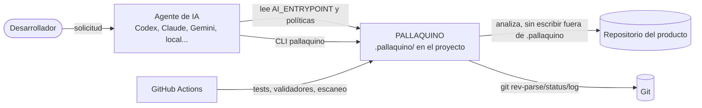
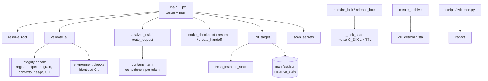
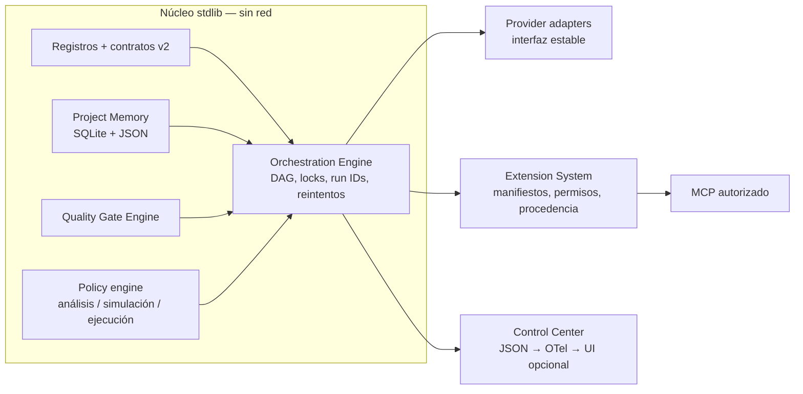

# Arquitectura de PALLAQUINO

Estado de cada elemento: **IMPLEMENTADO** (código + tests en 0.3.0),
**EXPERIMENTAL** (código sin contrato estable) o **PLANIFICADO** (solo diseño).

## 1. Principios que no cambian

Portable, provider-neutral, secure by default, extensible, trazable y developer
first. El núcleo usa solo la Standard Library de Python 3.11+, funciona sin red y
trata todo contenido del repositorio, la memoria o un proveedor como **datos**, nunca
como instrucciones de mayor jerarquía (`governance/POLICY_HIERARCHY.md`).

## 2. Contexto (C4 nivel 1)

PALLAQUINO no llama todavía a ningún proveedor de IA: el agente activo es quien
lee las políticas y usa el CLI. Esa separación es deliberada y se conserva.

## 3. Contenedores (C4 nivel 2)

| Contenedor | Ubicación | Estado |
|---|---|---|
| Políticas y modos | `governance/`, `modes/`, `AI_ENTRYPOINT.md` | IMPLEMENTADO (texto normativo) |
| Registros | `registry/*.json` (agentes, skills, rutas, tecnologías, perfiles) | IMPLEMENTADO + validado |
| Pipeline | `pipeline/pipeline_definition.json` (32 etapas + gates) | IMPLEMENTADO como datos; sin motor de ejecución |
| Continuidad | `continuity/` (estado, checkpoints, handoff) | IMPLEMENTADO |
| Núcleo | `pallaquino_cli/core.py` | IMPLEMENTADO |
| CLI | `pallaquino_cli/__main__.py` | IMPLEMENTADO |
| Scripts | `scripts/` (validación, evidencia, release, generadores) | IMPLEMENTADO |
| Motor de orquestación | — | PLANIFICADO (Fase 2) |
| Project Memory | — | PLANIFICADO (Fase 2) |
| Adaptadores de proveedor | `providers/capabilities.json` (solo datos) | PLANIFICADO (Fase 2) |
| Extension System / MCP | — | PLANIFICADO (Fase 3) |
| Project Factory | — | PLANIFICADO (Fase 4) |
| Control Center | salida JSON del CLI | IMPLEMENTADO (JSON); UI PLANIFICADA (Fase 5) |

## 4. Componentes del núcleo (C4 nivel 3, 0.3.0)

### Contratos relevantes

- **Resolución del root** (ADR-0004): `--root` → `$PALLAQUINO_ROOT` → checkout del
  paquete → `./.pallaquino` o un padre. Root inválido: exit 2 y mensaje accionable.
- **Validación** (ADR-0001): cada check lleva `scope`. `ok` agrega solo los checks
  incluidos; `--integrity-only` excluye los dependientes del host.
- **Estado por proyecto** (ADR-0003): `manifest.json#instance_state` es la lista
  declarativa de lo que `init` nunca copia.
- **Códigos de salida del CLI**: 0 éxito; 1 validación fallida o error operativo;
  2 root no resoluble.

## 5. Estados y transiciones

El pipeline es lineal en éxito y declara `failure_return_to` por etapa
(`pipeline/pipeline_definition.json`, validado por `validate_pipeline`). Los
checkpoints guardan `task`, `stage`, `git_head`, `git_diff` y un SHA-256 del
contenido; `resume` recorre del más nuevo al más antiguo, omite los corruptos y, si
no hay ninguno válido, devuelve `RECONSTRUCTED` con confianza baja.

Límite conocido: el checksum detecta corrupción accidental, no manipulación
deliberada (no hay clave ni cadena de hashes). La auditoría a prueba de
manipulación es parte de la Fase 2.

## 6. Arquitectura de evolución propuesta

Reglas de evolución:

1. Todo motor nuevo vive detrás del CLI y se prueba en aislamiento con fixtures.
2. Las dependencias externas (embeddings, SDKs de proveedor, UI web) son
   extensiones opcionales que el núcleo no importa.
3. Cada ejecución tendrá un `run_id`; la evidencia y los checkpoints se asociarán a él.
4. Ningún componente nuevo puede ejecutar acciones destructivas sin la aprobación
   descrita en `HUMAN_APPROVAL_POLICY.md`.

El detalle por fase, dependencias y criterios de aceptación está en
[`ROADMAP.md`](ROADMAP.md); las decisiones, en [`adr/`](adr/).
