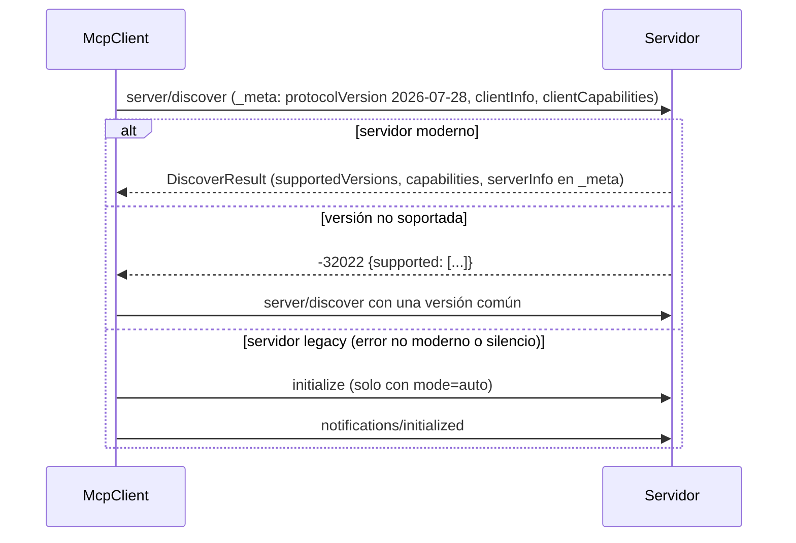

# PALLAQUINO MCP Integration Engine (v0.5.0)

Estado: **IMPLEMENTADO**. Código: `pallaquino_cli/mcp/`. Decisiones: [ADR-0014](../adr/ADR-0014-mcp-client-2026-07-28.md) y
[ADR-0016](../adr/ADR-0016-credentials-oauth-and-network-policy.md). Especificación objetivo: **MCP 2026-07-28**, consultada el
2026-10-14 en https://modelcontextprotocol.io/specification/2026-07-28.

## Módulos

| Módulo | Responsabilidad |
|---|---|
| `protocol.py` | constantes 2026-07-28; claves `_meta`; códigos de error (-32020/-32021/-32022); `resultType`; codificación de cabeceras (centinela base64); validación de `x-mcp-header` |
| `transports.py` | `StdioTransport` (subproceso, entorno saneado, stderr acotado, `notifications/cancelled`, cierre escalonado) y `HttpTransport` (POST por mensaje, JSON o SSE, cancelación cerrando el stream, IP fijada) |
| `client.py` | `McpClient`: `server/discover`, negociación de versión, fallback legacy, catálogos con paginación y caché `ttlMs`, MRTR, Tasks, validación de esquemas y tamaños, digest de definición |
| `server.py` | servidor de referencia 2026-07-28 para stdio y Streamable HTTP. Lo usan el SDK, la demo y los tests |
| `connections.py` | registro persistente de conexiones, estados, diagnóstico, revisión y fijación de catálogo, y puente al registro de herramientas |
| `auth.py` | `CredentialStore`, descubrimiento OAuth, PKCE, validación de `iss`, intercambio de código, refresh y revocación; flujo loopback |
| `netpolicy.py` | política de red anti-SSRF |

## Conexión

En HTTP, cada POST lleva `MCP-Protocol-Version` y `Mcp-Method`. Las peticiones `tools/call`, `resources/read` y `prompts/get` llevan
además `Mcp-Name`, y los parámetros anotados con `x-mcp-header` se reflejan en `Mcp-Param-*`. Las herramientas con `x-mcp-header` inválido
se excluyen del catálogo con un aviso.

## Estados de conexión

CONFIGURED, DISCONNECTED, CONNECTING, CONNECTED, DEGRADED (el catálogo cambió desde que se fijó), AUTH_REQUIRED, FAILED y DISABLED.

- La configuración persistente (`connection`) está separada del catálogo revisado (`catalog`) y del estado de transporte, que vive en
  memoria del proceso.
- Una conexión caída solo deja no disponibles sus herramientas: el resto de PALLAQUINO sigue funcionando
  (`test_a_failed_server_does_not_stop_the_platform`).

## Extensiones

| Extensión | Estado |
|---|---|
| Tools, Resources, Prompts (core) | implementado |
| Multi Round-Trip Requests | implementado; el input se deniega salvo un manejador autorizado |
| Tasks (`io.modelcontextprotocol/tasks`) | implementado, opt-in por conexión (`extensions`); polling, cancelación, límite temporal |
| Progreso y cancelación | implementado (SSE en HTTP; notificaciones en stdio) |
| `subscriptions/listen` | no implementado |
| Roots, Sampling, Logging | no implementados (en desuso en 2026-07-28) |
| HTTP+SSE 2024-11-05 | no implementado (en desuso) |

## Tasks frente al scheduler

Una tarea MCP es un identificador externo (`taskId`) que vive mientras dura una llamada a herramienta. La tarea de PALLAQUINO (`T03`, por
ejemplo) es la unidad del scheduler. La relación queda en la evidencia de la llamada (`tool_calls.body.result.task`). Un `timeout` del
gateway pide `tasks/cancel`.
