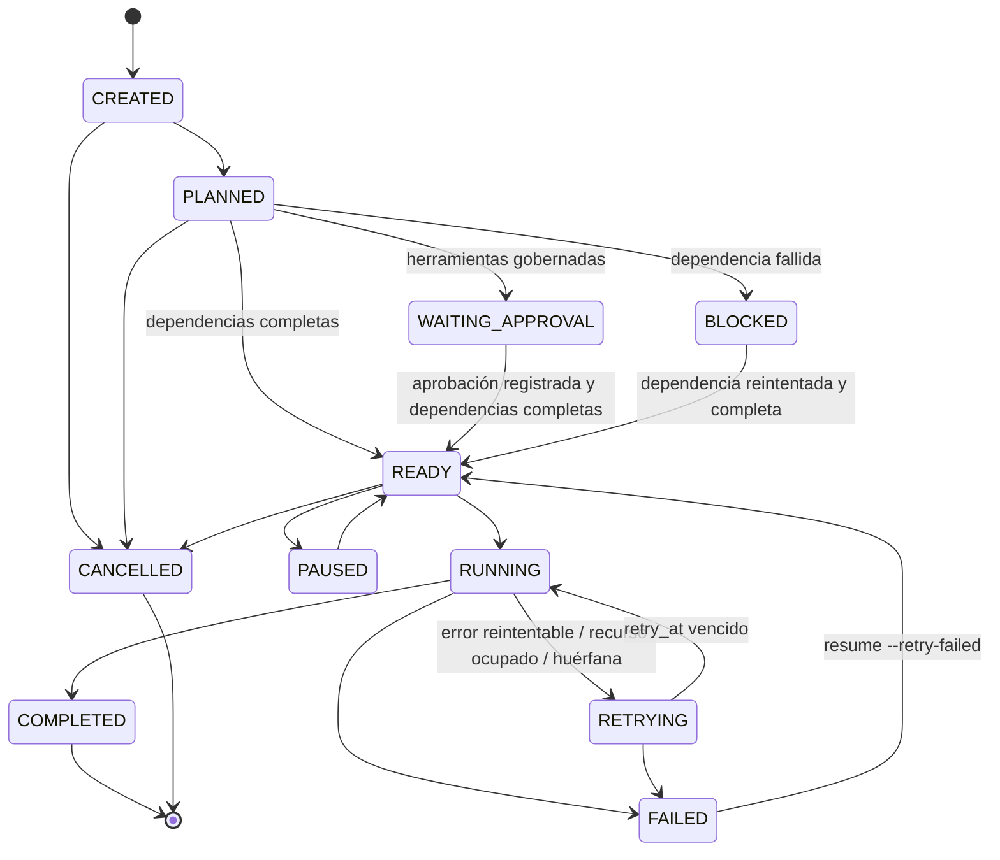

# PALLAQUINO Multi-Agent Scheduler

Estado: **IMPLEMENTADO** (`pallaquino_cli/orchestration/scheduler.py`).

## Máquina de estados de tarea

Una transición no declarada lanza `InvalidTransition`. La ejecución tiene su propia máquina: CREATED, RUNNING, WAITING_APPROVAL,
PAUSED, COMPLETED, FAILED y CANCELLED.

## Bucle de ejecución

1. Renueva el lease del runner (un tercio del lease) y relee los indicadores de cancelación y pausa desde SQLite. Así los controla otro proceso (`pallaquino cancel|pause`).
2. Promueve las tareas: bloqueadas si una dependencia falló; listas si todas completaron, no requieren aprobación o ya fue registrada.
3. Lanza tareas `READY` o `RETRYING` vencidas hasta `max_workers`. Cada intento recibe un token y un dueño de locks `ejecución:tarea:token`.
4. Espera la primera tarea terminada o el vencimiento de su timeout. Los resultados con token obsoleto se ignoran.
5. Aplica el resultado:
   - **éxito**: handoff validado, transición a COMPLETED y, si corresponde, ronda de revisión o delegación;
   - **fallo**: reintento con backoff `backoff_base·2^(n-1)`; si no hay reintento, FAILED y bloqueo transitivo de los dependientes.

## Garantías y límites

| Tema | Comportamiento |
|---|---|
| Semántica de entrega | at-least-once; las escrituras se registran (write-ahead) y se reconcilian por SHA-256 al reanudar |
| Timeouts | por tarea (`task_timeout`) y por comando (`command_timeout`). Un hilo que excede el tiempo no se puede matar: su resultado tardío se descarta, pero sus efectos ya ocurridos no se deshacen |
| Concurrencia | `ThreadPoolExecutor(max_workers)`; locks de recurso (`resources`) y de archivo en SQLite con lease |
| Esperar un lock | no consume intentos (`resource_busy` → RETRYING a los 50 ms) |
| Conflictos de escritura | si el agente declara `expected_sha256` y el archivo cambió → `write_conflict`, no reintentable |
| Cancelación | las tareas en curso terminan su intento; ninguna nueva empieza; el resto pasa a CANCELLED |
| Pausa | ninguna tarea nueva empieza; las READY pasan a PAUSED; el lease se libera; `resume` continúa |
| Runner concurrente | si otro runner tiene un lease vigente → `ExecutionLocked` (salvo `--force`) |
| Revisión | `max_review_rounds` (2): cada `request_changes` añade una tarea de corrección y una nueva revisión, y los dependientes pasan a esperar esa nueva revisión. Al agotar las rondas, la revisión falla |
| Delegación | `max_delegation_depth` (2); se rechazan ciclos; la tarea delegada recibe la intersección de herramientas, nunca más |
| Persistencia | cada transición y cada evento se escriben en SQLite (WAL) antes de continuar |

## Medido

Rendimiento con tareas simuladas de 10 ms: 37 tareas/s con 1 worker y 84 con 4 (ver [BENCHMARK_RESULTS.md](../evaluation/BENCHMARK_RESULTS.md)).
A partir de 4 workers el límite es la persistencia por transición en SQLite.
