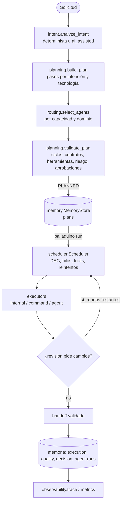

# PALLAQUINO Intelligent Orchestration Engine (v0.4.0)

Estado: **IMPLEMENTADO**. Código: `pallaquino_cli/orchestration/`. Decisión: [ADR-0010](../adr/ADR-0010-orchestration-engine.md).

## Flujo real

| Etapa del pedido | Componente | Notas |
|---|---|---|
| Intent & Context Analyzer | `intent.py` | 14 intenciones, multi-intención, tecnologías del catálogo, alcance desde el mapa del repositorio |
| Project Discovery | paso `discover` → ejecutor `internal` | `compute_repository_map` real; el resultado se guarda como memoria de proyecto |
| Risk & Permission Engine | `core.analyze_risk` + contratos v2 | riesgo determinista; herramientas por contrato; gobernadas → aprobación |
| Intelligent Task Planner | `planning.py` | 24 pasos de biblioteca, DAG, niveles paralelos, ruta crítica |
| Agent & Skill Selector | `routing.py` | ver [AGENT_ROUTING.md](AGENT_ROUTING.md) |
| DAG Task Scheduler | `scheduler.py` | ver [MULTI_AGENT_SCHEDULER.md](MULTI_AGENT_SCHEDULER.md) |
| Agentes | `executors._agent` | contrato v2 cargado con verificación de digest; salida JSON validada |
| Review & Quality Gates | pasos `verify` (comando real), `code_review`, `security_review` | la revisión de un agente no sustituye al `verify` ejecutable |
| Result Aggregator | handoffs + `_finalize` | estado final derivado de los estados de tarea |
| Memory & Checkpoint | `memory/store.py` | ver [MEMORY_ENGINE.md](MEMORY_ENGINE.md) |
| Report & Handoff | `observability.py`, `executions report` | traza reconstruida solo desde estado persistido |

## Contratos

| Contrato | Productor | Campos clave |
|---|---|---|
| `intent_result` v1 | `analyze_intent` | request_id, intents[], primary_intent, confidence, scope, technologies, required_capabilities, risk (source=deterministic), permissions_required, suggested_agents/skills, acceptance_criteria |
| `task` v1 | `build_plan` | task_id, objective, dependencies, agent, routing, executor, tools, permissions, requires_approval, risk, acceptance_criteria, status, attempts, result, evidence, history |
| `plan` v1 | `build_plan` | tasks, dag (order, levels, critical_path), validation, approvals_required, estimates, revisions |
| `execution` v1 | `Scheduler.create_execution` | status, approvals, flags (cancel/pause), runner lease, usage, review_rounds, revisions |
| `handoff` v1 | `executors.build_handoff` | source/target agent, execution/task IDs, context_summary, artifacts, findings (fact/hypothesis), limitations, pending_actions, risk, validation_evidence, provenance |

## Lo que el motor no hace (todavía)

- No genera código por sí mismo: las tareas de agente necesitan un proveedor; sin uno real, el proveedor `mock` produce resultados marcados `simulated`.
- No ejecuta agentes externos interactivos (por ejemplo un asistente en otra ventana que entregue el resultado más tarde). Ver [ROADMAP_V040_TO_V050.md](../roadmap/ROADMAP_V040_TO_V050.md).
- No usa worktrees aislados por tarea: el aislamiento es por locks de recurso y archivo, más el confinamiento al workspace.
