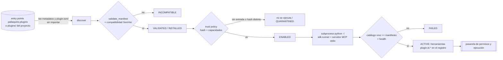

# PALLAQUINO Universal Plugin System (v0.5.0)

Estado: **IMPLEMENTADO**. Código: `pallaquino_cli/extensions/` (manifest, semver, discovery, manager) y `pallaquino_cli/sdk/`.
Decisión: [ADR-0013](../adr/ADR-0013-plugin-extension-system.md).

## Flujo

## Estados y transiciones

`PLUGIN_TRANSITIONS` en `extensions/manager.py` define los estados DISCOVERED, VALIDATED, INCOMPATIBLE, INSTALLED, DISABLED, ENABLED,
INITIALIZING, ACTIVE, DEGRADED, FAILED y QUARANTINED. Una transición no declarada lanza `PluginError`. Cada cambio se guarda en el store
(`platform_docs`, tipo `plugin`) con historial y evento (`plugin_*`).

| Operación | Qué hace | Qué nunca hace |
|---|---|---|
| discover / inspect / validate | lee metadatos y `plugin.toml`; calcula el hash | importar o ejecutar el plugin |
| install | copia un directorio, o un ZIP con SHA-256, en `plugins/<id>/<versión>/` | ejecutar scripts o instalar dependencias |
| trust | registra en `governance/plugin_trust.json` hash, capacidades y quién lo aprueba | ocurre solo por acción humana |
| enable | exige validación, compatibilidad, dependencias habilitadas y confianza | — |
| activate | arranca el proceso aislado, compara el catálogo y registra las herramientas | registrar herramientas no declaradas |
| update | instala la versión nueva junto a la anterior; si falla, la restaura | dejar el registro inconsistente |
| rollback | vuelve a la versión anterior registrada | deshacer efectos externos del plugin |
| uninstall | borra solo `plugins/<id>/`, creado por el gestor, y su entrada de confianza | borrar archivos de otros plugins o del proyecto |

## Tipos

Los 11 tipos del pedido se aceptan con un contrato común. En 0.5.0 solo aportan herramientas CORE_PLUGIN, TOOL_PLUGIN, MCP_CONNECTOR,
DATABASE_CONNECTOR, DEVOPS_CONNECTOR y QUALITY_GATE_PLUGIN (`TOOL_CONTRIBUTING_TYPES`). Los demás (AGENT, SKILL, PROVIDER_ADAPTER,
OBSERVABILITY, PROJECT_TEMPLATE) se validan y registran, pero todavía no tienen punto de carga. Es uno de los puntos de extensión
preparados para 0.6.0.

## Aislamiento

- El proceso se lanza con `python -I`, que ignora PYTHONPATH, user-site y el directorio actual. Un bootstrap añade solo el framework y la
  ruta del plugin.
- El entorno se sanea: solo variables esenciales del sistema operativo, sin tokens.
- El directorio de trabajo es temporal y el workspace se pasa solo si el plugin pide FILE_READ, FILE_WRITE, GIT_READ o DATABASE_READ.
- `ToolCall.resolve` confina las rutas al workspace.
- **Límite declarado**: no es un sandbox del sistema operativo. Un plugin confiable ejecuta código con los permisos del usuario. La defensa
  es la revisión humana del contenido, ligada al hash, más la pasarela.

## Evidencia

`tests/test_plugins.py` (14 tests) cubre:

- descubrimiento sin importar (el módulo aborta si se importa);
- inválidos, incompatibles y duplicados;
- distribución con entry point en un site aislado e instalación real con `pip --target`;
- no confiable nunca ejecuta;
- manipulación → QUARANTINED;
- capacidades de más;
- fallo de inicialización;
- catálogo que no coincide;
- plugin malicioso: fuga de rutas y lectura del entorno;
- dependencias;
- ZIP con hash y con traversal;
- actualización fallida con rollback;
- desinstalación acotada.
